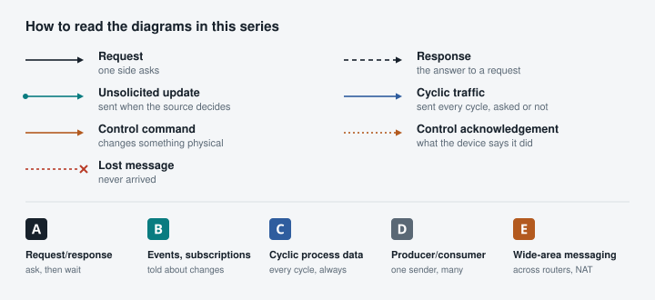

import SeriesNav from '../../components/blog/SeriesNav.astro';
import SeriesLink from '../../components/blog/SeriesLink.astro';
import Callout from '../../components/Callout.astro';

In software engineering, reading a value usually sounds straightforward: send a request and wait for a response.

Industrial automation has a few surprises.

Reading a Modbus meter may require polling it every second. An OPC UA server can report changes through subscriptions. A DNP3 outstation can retain time-stamped events for later retrieval. A CANopen device can broadcast process values to other nodes on a shared bus. A PROFINET device may exchange its I/O image every few milliseconds, without an application-level read request at all.

And that is before we attempt to write a value, operate a breaker, or manage a disconnected EV charger.

Across OT Fabric, we implement industrial protocols with very different histories and communication models. Looking at them side by side reveals something interesting: the hardest part is not always decoding a packet. It is understanding the communication contract.

This guide is the entry point of a series for software engineers and architects who are building software that talks to industrial equipment. It is not a certification guide and it does not teach any one specification. It explains why fourteen protocols behave so differently, and what that means for the software around them.

<SeriesNav current="industrial-protocols-software-architecture" />

## Why these protocols are different

Industrial protocols were not designed by one committee for one problem. Each grew out of an industry, with its own equipment, its own failure modes and its own idea of what "real time" means.

- **Factory automation**: [Siemens S7comm](/protocols/s7/), [EtherNet/IP](/protocols/ethernet-ip/), [PROFINET](/protocols/profinet/) and [CANopen](/protocols/canopen/). A controller scans its I/O every few milliseconds and a missed deadline stops a machine. These protocols separate configuration, which may be slow, from process data, which must arrive on time.
- **Utilities and power automation**: [IEC 60870-5-104](/protocols/iec-104/), [DNP3](/protocols/dnp3/) and [IEC 61850](/protocols/iec-61850/). A control centre watches thousands of points over links that used to be slow, shared or expensive. The design answer was to report changes as time-stamped events, to keep them until someone confirms them, and to control switchgear in deliberate, checked steps.
- **Buildings**: [BACnet/IP](/protocols/bacnet/) and [KNX](/protocols/knx/). Many small devices from many vendors, installed by integrators, running for decades. BACnet models devices as objects with properties and change notifications; KNX lets a switch talk to a light through a group address without any central controller.
- **Industrial integration**: [Modbus](/protocols/modbus/) and [OPC UA](/protocols/opc-ua/). Modbus is the lowest common denominator: registers, a request and an answer. OPC UA is the opposite end: a typed address space, sessions, subscriptions, events and security.
- **Distributed energy and EV charging**: [OCPP](/protocols/ocpp/), [OpenADR](/protocols/openadr/) and [IEEE 2030.5](/protocols/ieee-2030-5/). The equipment sits behind customer routers, on mobile networks and on the public internet. These protocols use HTTP, WebSockets and TLS, and they assume the device will be offline at times.

Five forces explain most of the differences: how tight the timing is, how long equipment stays in the field (twenty or thirty years is normal), what the network could carry when the protocol was designed, whether one central system is in charge, and whether the history of what happened matters as much as the current value. A protection engineer needs the order and time of events; a building controller mostly needs the current temperature.

## Five patterns, not fourteen wire formats

Five patterns cover the communication behaviour of all fourteen protocols. They are lenses, not boxes: most protocols use several of them, and the interesting questions are often where one protocol combines two.

**A. Explicit request/response.** One participant asks for an operation and the other answers: a Modbus register read, an S7 read of a data block, BACnet ReadProperty, OPC UA Read, a CANopen SDO upload. The engineering concerns are outstanding requests, concurrency limits, timeouts, retries and how often to poll.

**B. Subscriptions and event-oriented reporting.** A participant receives updates without asking for each value again: BACnet change-of-value (COV), OPC UA monitored items, IEC 61850 reports, IEC 104 spontaneous transmission, DNP3 unsolicited responses. The concerns move to subscription lifetime, buffering, acknowledgements, ordering and what happens to a gap.

**C. Cyclic process-data exchange.** Devices exchange process data on a configured cycle, whether or not anything changed: PROFINET RT, EtherNet/IP implicit (Class 1) I/O, synchronous CANopen PDOs, IEC 61850 Sampled Values. The concerns are cycle time, jitter, deadlines, watchdogs and the moment data stops being fresh.

**D. Producer/consumer and group communication.** Data is produced once for whoever needs it, rather than returned to one requester: KNX group telegrams, CANopen PDOs, IEC 61850 GOOSE, OPC UA PubSub. The concerns are addressing, fan-out, multicast, filtering, sequence numbers and how a receiver knows its data is still valid.

**E. Wide-area application messaging.** Long-lived or HTTP-based relationships across networks nobody controls end to end: OCPP, OpenADR, IEEE 2030.5. The concerns are NAT and firewalls, who owns the connection, reconnects, credentials, scheduled operations and catching up after an offline period.

### Four dimensions that are easy to confuse

Before comparing protocols, separate four questions that are often merged into one:

- **Synchronous or asynchronous** describes whether the caller waits. It is a property of the API, not of the wire.
- **Request/response or one-way** describes whether a message expects an answer.
- **Polling or publishing** describes who decides when data moves.
- **TCP or UDP** describes the transport, and says little about the application contract.

A TCP connection can carry asynchronous application messages in both directions, as OCPP does. An asynchronous notification can still require an acknowledgement, as a DNP3 unsolicited response does. A UDP protocol can implement confirmed transactions with retries, as BACnet/IP does. And publish/subscribe does not imply a broker: OPC UA PubSub over UDP multicast, KNX routing and GOOSE have none. Keeping these dimensions apart prevents most of the misleading comparisons you will find elsewhere.

## The comparison matrix

The two tables compress each protocol to its characteristic behaviour. The exceptions, options and version differences are in the linked articles and in the protocol documentation.

**Who talks to whom.** Transport and roles:

| Protocol | Transport | Roles |
|---|---|---|
| [Modbus](/docs/protocols/modbus/) | TCP 502; RTU and ASCII on serial | Client/server |
| [OPC UA](/docs/protocols/opc-ua/) | TCP 4840 (also WebSocket, HTTPS); PubSub over UDP, Ethernet, MQTT, AMQP | Client/server, optional reverse connect; PubSub publisher/subscriber |
| [BACnet/IP](/docs/protocols/bacnet/) | UDP 47808; BBMDs across subnets | Client/server per service; any device can be both |
| [IEC 104](/docs/protocols/iec-104/) | TCP 2404 | Controlling station / controlled station |
| [IEC 61850](/docs/protocols/iec-61850/) | MMS on TCP 102; GOOSE and Sampled Values on Ethernet | Client/server; publisher/subscriber |
| [Siemens S7comm](/docs/protocols/s7/) | ISO-on-TCP (TPKT, COTP), TCP 102 | Client/server; the PLC serves |
| [DNP3](/docs/protocols/dnp3/) | TCP or UDP 20000; serial | Master/outstation |
| [EtherNet/IP](/docs/protocols/ethernet-ip/) | TCP 44818 explicit; UDP 2222 implicit | Client/server; originator/target; producer/consumer |
| [PROFINET](/docs/protocols/profinet/) | Ethernet frames for RT; DCE/RPC over UDP for setup and records | IO-controller, IO-device, IO-supervisor |
| [CANopen](/docs/protocols/canopen/) | CAN | SDO client/server; PDO producer/consumer; NMT master |
| [KNX](/docs/protocols/knx/) | TP1 bus; KNXnet/IP tunnelling and routing, UDP 3671 | Group senders and receivers |
| [OCPP](/docs/protocols/ocpp/) | WebSocket, JSON, over TLS | Charger is the WebSocket client; both sides send calls |
| [OpenADR 3](/docs/protocols/openadr/) | HTTPS REST; webhook and MQTT notifications | VTN server; VEN and business-logic clients |
| [IEEE 2030.5](/docs/protocols/ieee-2030-5/) | HTTPS with client certificates, XML or EXI | Server; clients poll, optional subscriptions |

**How data, control and recovery work:**

| Protocol | Read path | Write path | Events and alarms | After a failure |
|---|---|---|---|---|
| Modbus | Explicit reads, polled | Write registers or coils; the reply echoes the request | None | Poll again |
| OPC UA | Read; subscriptions with monitored items | Write; method calls | Events, Alarms and Conditions | Reactivate session, transfer or recreate subscriptions, Republish, ConditionRefresh |
| BACnet/IP | ReadProperty(Multiple); SubscribeCOV | WriteProperty, with a 16-level priority array | Event notifications to recipient lists; AcknowledgeAlarm | Renew COV subscriptions; GetEventInformation for active events |
| IEC 104 | General interrogation, then spontaneous data | Commands with select/execute; ACTCON and ACTTERM | Spontaneous, time-tagged ASDUs; station-side buffering | STARTDT, general interrogation, clock synchronization |
| IEC 61850 | Reads; buffered and unbuffered reports; Sampled Values | Control models: direct or select-before-operate, normal or enhanced security | Reports, GOOSE state changes, logs | Resume buffered reports by EntryID; general interrogation; next GOOSE repeat |
| Siemens S7comm | Explicit reads of DBs, inputs, outputs, markers | Explicit writes | Not used by typical third-party clients | Poll again |
| DNP3 | Integrity and event polls; unsolicited responses | Control relay output blocks and analog outputs, select-before-operate or direct | Class 1 to 3 events, buffered until confirmed | Event poll, integrity poll, IIN flags |
| EtherNet/IP | Explicit reads; input data every RPI | Explicit writes; output data in every packet | No event history; change-of-state connections | Forward_Open again |
| PROFINET | Input data every cycle | Output data every cycle; record writes | Diagnosis and process alarms, acknowledged | Re-establish the application relationship |
| CANopen | SDO uploads; PDOs on SYNC or on change | SDO downloads; receive PDOs | Emergency messages; heartbeat | NMT commands, re-read by SDO |
| KNX | Group telegrams; group reads | Group writes, unanswered | Status on separate group addresses; no history | Read status objects |
| OCPP | Meter values, status and transaction messages from the charger | Calls from the CSMS, such as RequestStartTransaction and SetChargingProfile | Status and event notifications | BootNotification, status, queued transaction messages |
| OpenADR 3 | VEN polls or is notified | Events with intervals; VEN posts reports | Object notifications | Read the VTN again; state lives on the server |
| IEEE 2030.5 | GET at the server’s pollRate; notifications | DER controls with start time and duration; Responses | Notifications to subscribers | Poll again; fetched schedules keep running |

[CAN bus](/protocols/can-bus/) is not in the tables because it is a transport rather than an application protocol, but its arbitration and broadcast nature shape everything CANopen does. MQTT appears in this series as a point of comparison for brokered publish/subscribe, and [Sparkplug B](/profiles/sparkplugb/) as an example of state on top of it, but neither is analysed as a protocol here.

## Who initiates communication?

The participant that opens a connection is not necessarily the one that asks the questions afterwards. Three protocols make the point.

In **Modbus/TCP** the two coincide. The client opens the TCP connection and sends every request; the server only answers. A Modbus server never speaks first.

In **OCPP** they split. The charging station opens a WebSocket to its management system, the CSMS, because the charger is the one behind a customer router or a mobile network that would never accept an incoming connection. Once the WebSocket is up, both sides send requests: the charger sends BootNotification and TransactionEvent, the CSMS sends RequestStartTransaction and SetChargingProfile. The transport client is an application server for half the conversation.

In **KNX** the question barely applies. A wall switch sends a GroupValue_Write to a group address; every device that has a communication object linked to that address acts on it. Nobody opened a session, nobody is the server, and the sender does not know who listened.

OPC UA adds a further twist with reverse connect, where the server opens the TCP connection to the client so that a device inside a plant network can reach a client outside it without an inbound firewall rule; after that, the client still opens the session and sends the requests.

So a software design needs at least three separate concepts: who owns the network connection, which application role each side plays, and in which direction each message type flows. <SeriesLink to="industrial-client-server-pubsub-roles">Who is the client?</SeriesLink> works through roles, bidirectional RPC and publish/subscribe in detail.

## How does data move?

Polling, subscriptions, spontaneous reporting, event queues and cyclic exchange answer the same question in different ways: who decides when the application gets a value?

- With **polling**, the application decides. Modbus and S7 clients read on a schedule. The cost is paid every cycle whether or not the value changed, and anything that happens between two reads is invisible.
- With a **subscription**, the application decides *what* it wants and the server decides *when* to send it. A BACnet COV subscription has a lifetime and must be renewed. An OPC UA subscription samples values at one interval and publishes notifications at another.
- With **spontaneous reporting and event queues**, the device decides. An IEC 104 station sends a spontaneous ASDU when a point changes; a DNP3 outstation stores events in classes and sends them unsolicited or when polled, and keeps each one until the master confirms it.
- With **cyclic exchange**, the configuration decides. A PROFINET IO-device sends its inputs every cycle once the relationship exists; nobody asks for them.

A subscription is not necessarily an unsolicited packet in the literal sense. OPC UA notifications travel as responses to Publish requests that the client keeps queued at the server; the server decides when to answer, but the client still sent the request first. The behaviour is event-driven while the wire is request/response, which is exactly why the four dimensions above need to stay separate.

<SeriesLink to="industrial-protocol-read-patterns">Reading industrial data</SeriesLink> compares the read paths of nine protocols and shows when each one is the right fit. <SeriesLink to="industrial-data-time-freshness-ordering">Time, freshness and ordering</SeriesLink> follows the value after it arrives: how old it is, and whether it arrived in the order it happened.

## How does control work?

A write in a typical web API returns 200 and the database row has changed. Industrial writes are not that simple, because the thing being written is often a physical process.

- **Writing a Modbus holding register** returns an echo of the request. It means the device accepted the value. Whether an inverter has actually ramped down to the new power limit is a separate question that only a later reading can answer.
- **Select-before-operate**, in DNP3, IEC 104 and IEC 61850, splits a control into a selection, which reserves the output and checks the command, and an operation, which must repeat the same parameters within a timeout. IEC 104 and IEC 61850 with enhanced security then send a termination message when the operation has finished.
- **Cyclic outputs**, in PROFINET and EtherNet/IP, have no write request at all. The controller changes a byte in the output image and the next cycle carries it. There is no per-value acknowledgement; the inputs coming back are the feedback.
- **Remote EV charging commands** are accepted long before they take effect. An OCPP RequestStartTransaction answered with Accepted means the charger will try; the transaction starts when the cable is connected and the session is authorized, and the charger reports it in a later message.

The common thread is that the response to a command tells you less than an API usually does. <SeriesLink to="industrial-protocol-write-control-semantics">Writing to industrial equipment</SeriesLink> separates delivered, accepted, executed and verified, and looks at what a timeout really means.

## What happens when the network fails?

Take a deliberately simple situation: a gateway is offline for two minutes. While it is away, an alarm is raised and cleared again.

- A **Modbus** poller comes back and reads the current value. The alarm never happened as far as it knows.
- A **BACnet** client resubscribes and reads the current state. The transient is gone unless the device kept it in an event log that the client then reads.
- A **DNP3** master runs an event poll and receives both events with their time stamps, because the outstation kept them until they were confirmed, and flags an overflow if it could not.
- An **IEC 61850** client with a buffered report resumes from the last entry it received.
- A **GOOSE** subscriber sees only the current state, but the jump in the state number proves that it missed something.
- A **KNX** gateway has lost the telegrams for good and must read every status object that allows it.

The same two minutes produce four different answers: a fresh read, recovered history, a known gap and silent loss. None of them is wrong; they are different contracts. <SeriesLink to="industrial-events-alarms-reliability">Industrial events and alarms</SeriesLink> compares eight protocols on delivery, persistence and recovery. <SeriesLink to="industrial-protocol-session-recovery">Reconnecting is not recovering</SeriesLink> covers the session state that has to be rebuilt, and <SeriesLink to="industrial-data-time-freshness-ordering">Time, freshness and ordering</SeriesLink> covers what the recovered data can and cannot tell you.

## What this means for software architecture

The usual first design for a multi-protocol system is a universal device client with `Read`, `Write` and `Subscribe`. It is attractive because it fits on a slide, and it fails in predictable ways:

- `Read` on a DNP3 point quietly turns an event-driven protocol into a polled one and throws away its time stamps.
- `Subscribe` on Modbus becomes a hidden poll loop whose rate nobody chose.
- `Write` returns success for a PROFINET output that is only carried in the next cycle, and for a breaker command that has been accepted but not executed.
- Cyclic I/O placed on a general-purpose scheduler shares its timing with everything else in the process.

A more honest structure has separate execution paths: a **polling scheduler** for request/response sources, an **event pipeline** with ordering, deduplication and backpressure, an **isolated cyclic I/O loop** with watchdogs, and a **command service** that tracks each command through its stages. Under each protocol sits its own **connection state machine**, often implemented as one actor per session, so that a reconnect means the protocol-specific recovery and not just a new socket.

A shared abstraction is still useful, as long as the differences stay visible: a capability that a protocol does not have should be absent, not emulated without saying so. <SeriesLink to="industrial-multiprotocol-gateway-architecture">Designing a multi-protocol gateway</SeriesLink> turns these lessons into interfaces and components, and <SeriesLink to="industrial-real-time-ethernet-fieldbus">Why industrial real-time communication is not just faster TCP</SeriesLink> explains why the cyclic path needs its own treatment.

## Conclusion

OT interoperability is not just the ability to exchange bytes with different equipment.

It is the ability to understand and honor different communication contracts: who owns the conversation, when information is exchanged, what constitutes an acknowledgement, and which state survives failure.

Those contracts should influence the software architecture rather than being hidden behind an overly generic API.

The series that follows takes one question at a time. Each article compares several protocols, uses three running examples (reading an inverter, operating a breaker, and managing an EV charger behind a customer router) and ends with a practical lesson for the software you are building.

<Callout title="Practical reference material">
Every protocol in this guide has an open-source implementation in OT Fabric, with documentation and an [interoperability suite](/blog/why-every-protocol-gets-an-interop-suite/) that tests it against independent stacks: [go-modbus](/projects/go-modbus/), [go-opcua](/projects/go-opcua/), [go-bacnet](/projects/go-bacnet/), [go-iec104](/projects/go-iec104/), [go-iec61850](/projects/go-iec61850/), [go-s7comm](/projects/go-s7comm/), [go-dnp3](/projects/go-dnp3/), [go-ethernetip](/projects/go-ethernetip/), [go-profinet](/projects/go-profinet/), [go-canopen](/projects/go-canopen/) on [go-canbus](/projects/go-canbus/), [go-knx](/projects/go-knx/), [go-ocpp](/projects/go-ocpp/), [go-openadr](/projects/go-openadr/) and [go-ieee20305](/projects/go-ieee20305/). Passing those suites shows interoperability with the stacks tested; it is not a conformance certification.
</Callout>

*Different wires. Different conversations. Different guarantees. One architectural perspective.*
