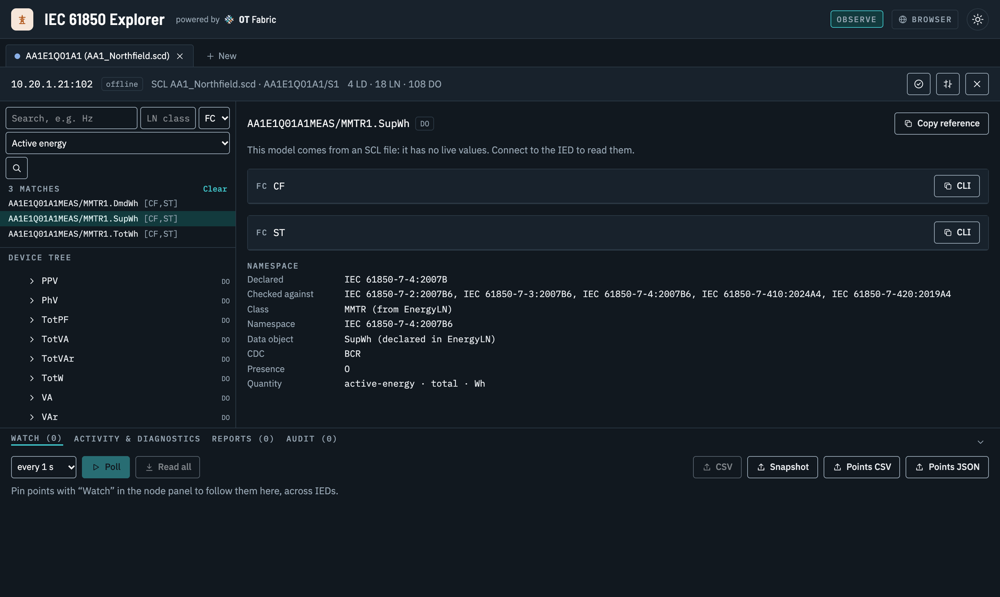
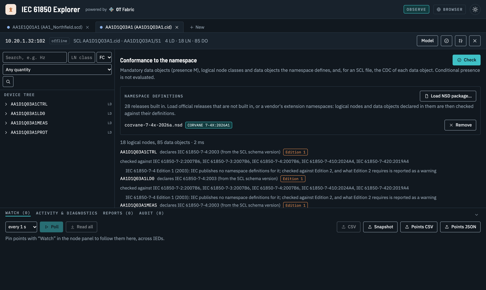
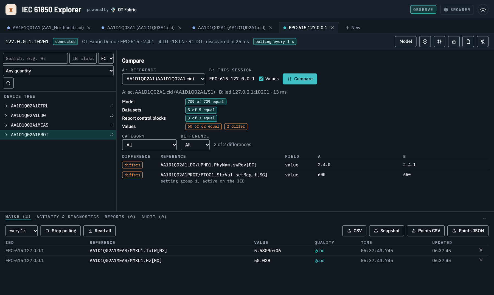
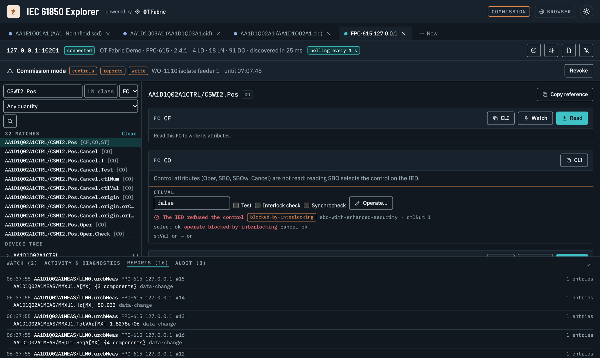
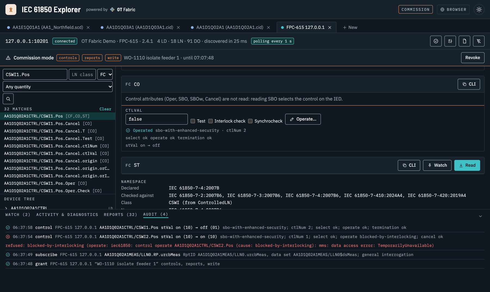
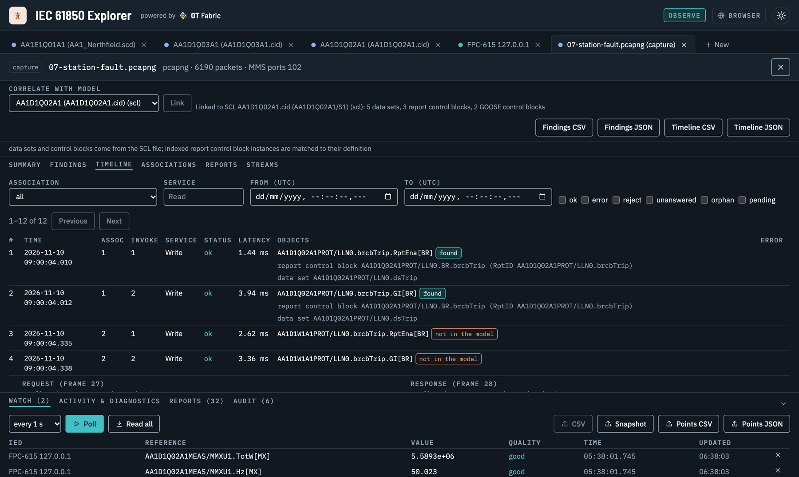
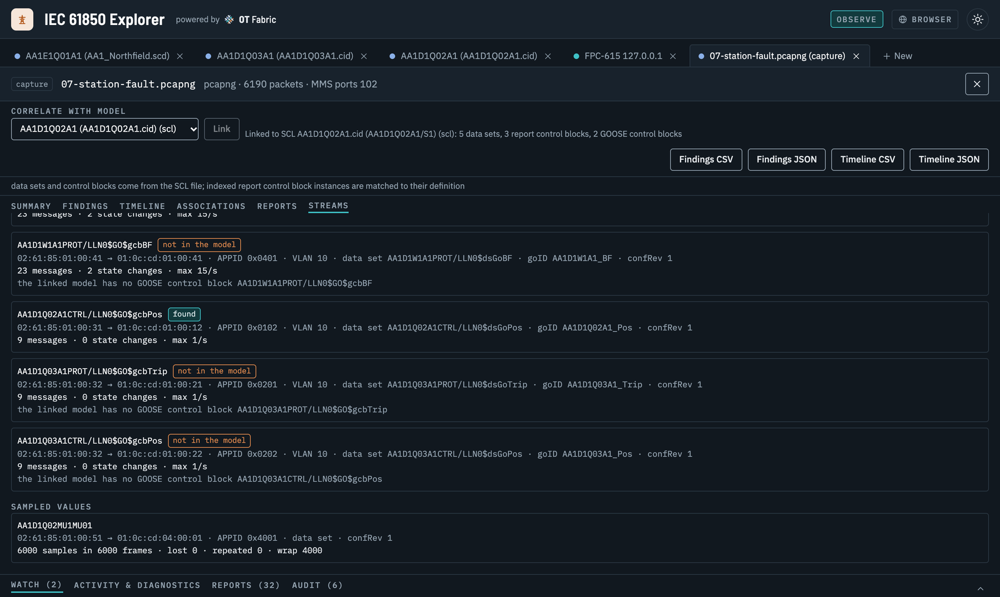
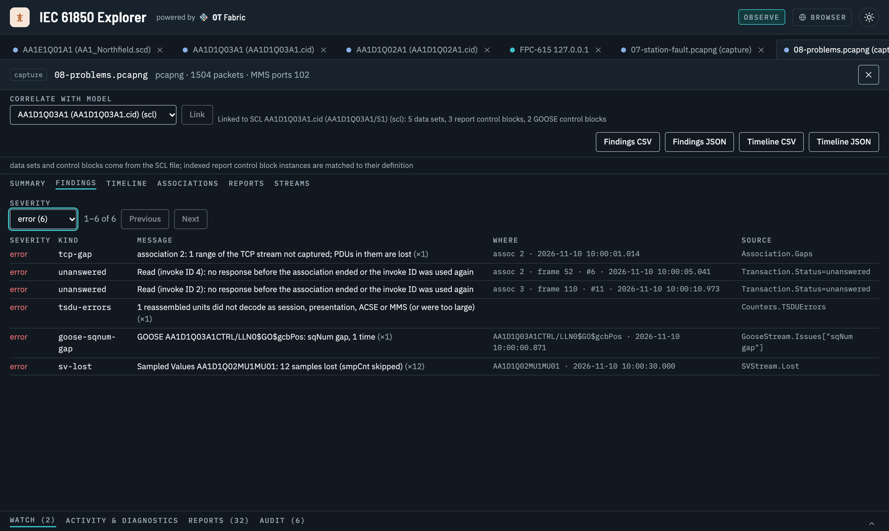

import Video from '../../components/Video.astro';
import Callout from '../../components/Callout.astro';

A substation is described down to the last attribute. The SCD file says which IEDs exist, which logical nodes they carry, which data sets feed which reports and which GOOSE messages trip which breakers. And yet the everyday questions are still hard to answer. Does this relay really run the configuration we approved? Which points measure active energy, so the SCADA list can be written? Why did the breaker failure protection operate this morning? Can I read the bay controller during a site visit without any risk of changing it?

The tools to answer them are usually split: one engineering tool per relay vendor, a generic MMS browser, an SCL editor, and Wireshark for the captures. Each sees part of the picture, and few of them are safe to point at a live installation by people who are not the protection engineer of record.

[IEC 61850 Explorer](/projects/iec61850-explorer/) brings those views into one open, vendor-neutral workbench. It connects to IEDs over MMS, opens SCL files and snapshots without a device, and reads packet captures of MMS, GOOSE and Sampled Values. All three share one model of the station, so a reference found in the SCD can be read on the IED and looked up in a capture of last night's fault.

<Video src="/videos/iec61850-explorer-demo.mp4" poster="/videos/iec61850-explorer-demo.jpg" caption="Three and a half minutes on AA1 Northfield, the made-up 110/20 kV substation that ships with the Explorer: search an SCD by quantity, check conformance, compare a live IED with its CID, operate a breaker in Commission mode and analyse captures of a fault." />

## Why it is different

**Safe by default.** Every session starts in Observe mode, and that is enforced in the MMS client, not in the user interface: it is built so that it cannot send a write, a control, a report or data set change, or a file change. You can hand the Explorer to a service technician, an integrator or an auditor and know that looking cannot become changing.

**Changes are deliberate and recorded.** When you do need to write a setting or operate a breaker, you grant Commission mode to one session, with a reason (a work order, say), a duration and only the capabilities you need. Changes then go over a second, restricted association, and every grant, subscription, write and control lands in an audit trail with its outcome.

**One model, three sources.** A live IED, an SCL file and a capture are all sessions you can browse, search, compare and export in the same way. That is what makes the comparisons possible: an IED against its CID, today against last year's snapshot, a capture against the model of the IED in it.

**Vendor-neutral and open.** It speaks IEC 61850, not a vendor's dialect, runs on macOS, Windows and Linux, and is MIT licensed like every OT Fabric project. Every value it reads shows the MMS item it came from and the equivalent [iec61850ctl](/projects/iec61850ctl/) command, so what you find by clicking can be scripted.

**It runs where the IEDs are.** IEDs often sit behind a gateway or an engineering host. Run the daemon there and use the same interface in your browser over an SSH tunnel, or connect through a SOCKS5 or HTTP proxy. The daemon only reaches the networks it is allowed to and asks for its access token on every request.

## Use cases

### Review a design before the hardware exists

Open the SCD or an IED's CID and browse it offline: logical devices, logical nodes, data objects and attributes, the data sets and report control blocks as the file defines them. Search by quantity instead of by class name. Ask for impedance, active energy or voltage and the Explorer finds the data objects that measure it, with their CDC, presence, phase and unit from the IEC 61850 namespace.



This is the work of SCADA and gateway engineering. The Explorer exports a **point list** of every attribute of an IED, with functional constraint, CDC, type, presence, quantity, unit and the data sets and reports that carry it, from the SCL file long before the IED is on site.

### Check conformance, Edition 1 and vendor extensions included

**Check** compares each logical device with the namespace it declares: mandatory data objects that are missing, classes and data objects the namespace does not define, and CDCs that differ. Edition 1 files are recognized and marked. A vendor's own namespace can be loaded as an NSD package, after which its extension data objects are checked against their definitions instead of showing up as findings.



This runs on [go-iec61850-model](/projects/go-iec61850-model/), which now embeds every namespace release IEC publishes, 28 in all, so a device is checked against the release it declares rather than the newest one.

### Commission and verify a live IED

Connect, and the Explorer discovers the IED's model and reads values with their quality and time stamp decoded: `good`, `questionable (old-data)`, and the time quality of the stamp. Pin points from several IEDs to one watch table and poll them. Inspect data sets in one request, report control blocks with their full configuration, logs by time range, setting groups, and the IED's files, such as the COMTRADE record of a fault.

Then prove the IED runs what is on file. **Compare** puts the IED next to its CID, configured values included. In the demo, the model, the five data sets and the three report control blocks are equal, and two values are not: someone updated the firmware, and someone changed the I> pickup on the front panel.



The same comparison works between any two sessions, so a site acceptance test can end with a snapshot that next year's inspection is compared against.

### Operate controls with every step visible

In Commission mode the Explorer operates controls of every control model: direct, select before operate, with normal or enhanced security. It shows each step, the select, the operate and the CommandTermination, and when the IED says no, it shows why. In the demo, the disconnector refuses to open while the breaker is closed: blocked by interlocking, exactly as the station was designed.





### Find out what happened on the station bus

After a fault, the evidence is often a capture from a mirrored switch port. Open the pcap or pcapng and the Explorer shows it in IEC 61850 terms: the MMS associations, a timeline of every confirmed service with its status and latency, the reports, and the GOOSE and Sampled Values streams with their state changes, rates and lost or repeated samples. Link the capture to the IED's SCL file or a live session and MMS names become IEC 61850 references, reports are decoded against their data sets, and their components get their names.





When the question is "what went wrong", the **findings** list it: TCP segments the capture missed, unanswered and failed requests, rejects, associations captured midstream or aborted, GOOSE sequence gaps and publisher restarts, lost Sampled Values. Each says where it is and which counter it comes from, and exports as CSV or JSON for the incident report.



<Callout type="note">
A finding describes the capture, not necessarily the wire. A segment the capture lost may still have reached the client; capture where both directions pass and keep whole packets. MMS over TLS cannot be decoded from a capture.
</Callout>

## Who it is for

- **Protection and control engineers** checking settings, configuration and behaviour during factory and site acceptance tests.
- **System integrators** building SCADA, gateway and EMS point lists from SCL, and verifying the IEDs answer as the file says.
- **Utilities and asset owners** who want to look at their own devices, and their own captures, without a vendor tool per relay.
- **Energy companies** connecting battery storage, solar and wind plants at medium and high voltage, where IEC 61850 is the plant controller's interface to the grid.
- **IED and gateway developers** who need an independent client and a capture analyser to test their implementation against.

## Built on open libraries

The Explorer is a thin layer over OT Fabric libraries that anyone can use on their own:

| Project | What it adds |
|---|---|
| [go-iec61850](/projects/go-iec61850/) and [go-mms](/projects/go-mms/) | The IEC 61850 client over MMS, SCL, GOOSE and Sampled Values, interop tested against five independent stacks |
| [go-mms-trace](/projects/go-mms-trace/) (new) | Offline analysis of pcap and pcapng captures: associations, transactions, reports, GOOSE and SV streams and counters. Its CLI, `mmstracectl`, gives the same answers as text, JSON or CSV, for scripts and incident tooling |
| [go-iec61850-model](/projects/go-iec61850-model/) | The information model from the official NSD files: search by quantity, conformance and the namespace of every data object |

```sh frame="terminal"
mmstracectl info station.pcapng
mmstracectl transactions station.pcapng --status error,reject,unanswered
mmstracectl goose station.pcapng --format csv > goose.csv
```

go-mms-trace is tested on captures recorded between five independent IEC 61850 stacks and on public captures, and its MMS decoding was compared by hand with Wireshark's dissector.

## Try it without hardware

The repository ships the demo substation from the video: an SCD and five CIDs (one of them Edition 1, one with a vendor namespace), eight packet captures, from a routine poll to a fault across MMS, GOOSE and Sampled Values and a capture full of problems, and its five IEDs served live from their CIDs. The [playbooks](https://github.com/otfabric/iec61850-explorer/blob/main/docs/PLAYBOOKS.md) walk through each use case above on it, step by step. To serve your own SCL file as an IED, use `iec61850ctl server start --scl device.cid`.

<Callout type="caution">
IEC 61850 Explorer is young and not certified. Its MMS client is go-iec61850 and go-mms, interop tested against independent software stacks, and go-mms-trace reads public captures from real IEDs, but the Explorer has not yet been validated against a broad range of physical IEDs. Rehearse Commission mode on a test set or a simulated IED before you use it on a live bay. Not yet supported: editing setting values, time-activated controls, live capture and MMS over TLS in captures.
</Callout>

## Get it

IEC 61850 Explorer is MIT licensed. The desktop application runs on macOS 13 or later, Windows (x86-64 and ARM64) and Linux with GTK 4 and WebKitGTK 6.0; the daemon is a static Linux binary for x86-64, ARM64 and ARMv7, and a container image. Downloads, with checksums and build provenance, are on the [releases page](https://github.com/otfabric/iec61850-explorer/releases/latest). The binaries are not code-signed yet, so macOS and Windows ask for confirmation on the first start.

Open your own SCD, connect to a test IED or drop in a capture, and tell us on [GitHub](https://github.com/otfabric/iec61850-explorer/issues) what your station shows.
