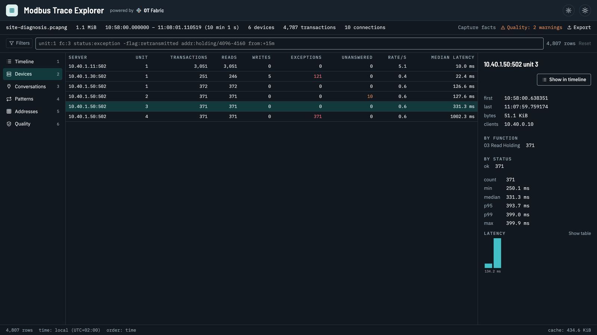
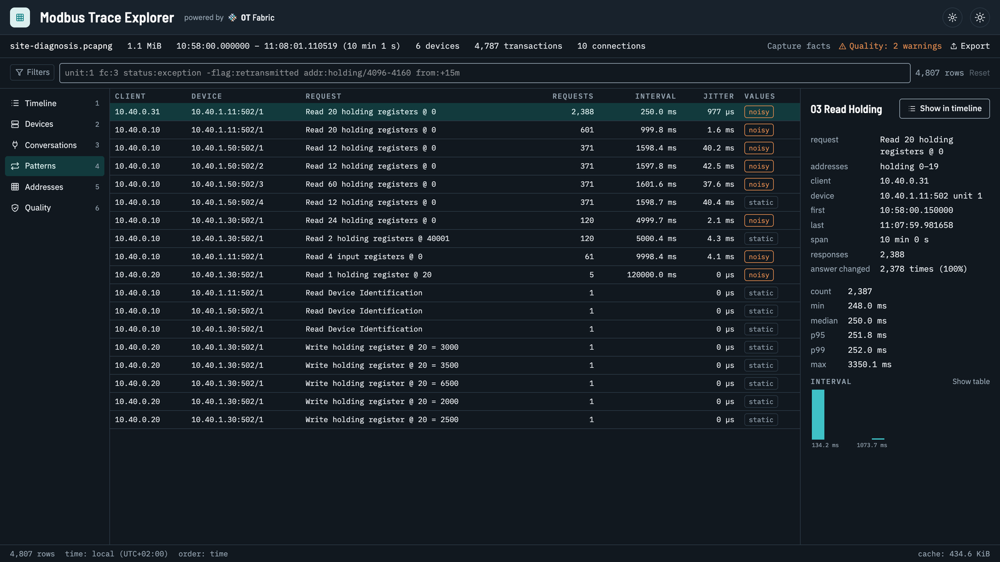
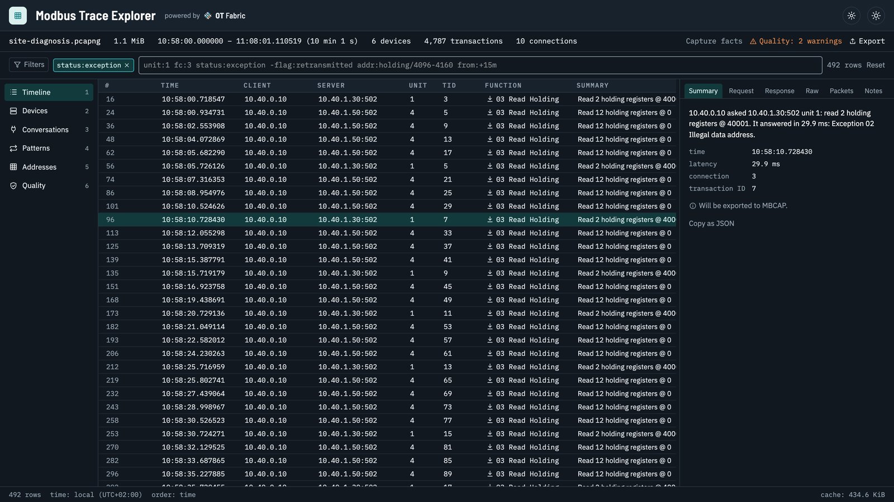
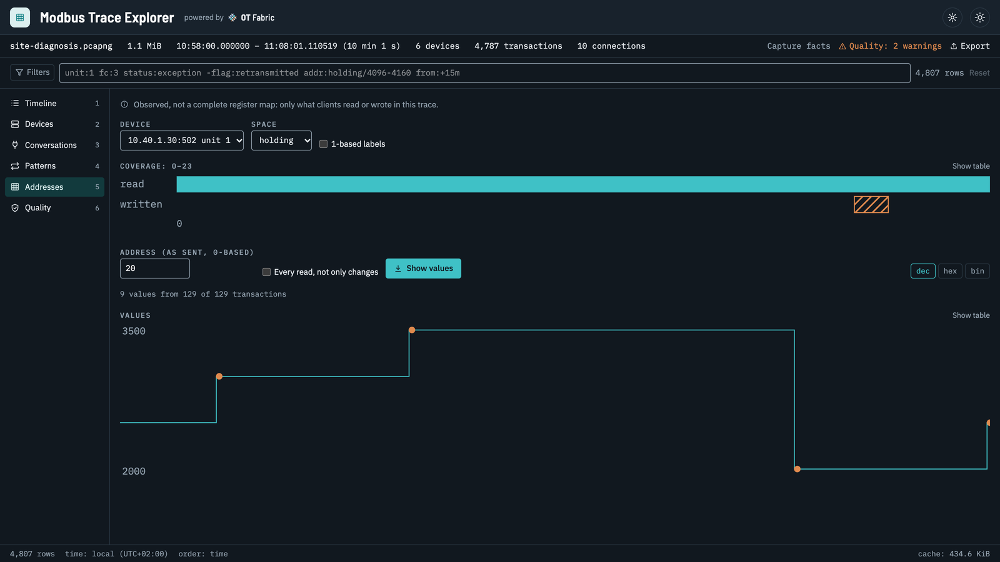
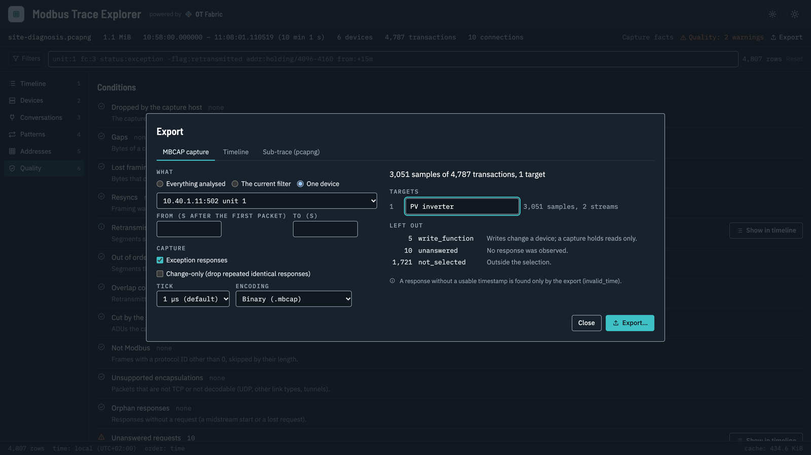

import Video from '../../components/Video.astro';
import Callout from '../../components/Callout.astro';

Data arrives late. A value is missing every few minutes. A gateway seems overloaded, a register reads garbage, and the integrator says the device is fine. Someone runs tcpdump next to the SCADA host, and now there is a trace of several thousand packets.

A packet tool shows that trace one packet at a time. The question, though, is about devices, polls and registers: which device holds up the cycle, who polls what and how often, which request gets an exception and why. [Modbus Trace Explorer](/projects/modbus-trace-explorer/) answers those questions. Open a pcap or pcapng file and it shows every request together with its response, per device, per poll and per register.

<Video src="/videos/modbus-trace-explorer-demo.mp4" poster="/videos/modbus-trace-explorer-demo.jpg" caption="Two minutes on a synthetic site trace: slow meters behind a gateway, duplicate polling, a register read with the wrong offset, and a device exported for replay." />

## What it shows

**Latency per device and unit.** Quantiles and a histogram for every server and every unit behind a gateway. In the demo trace, meters behind an RTU gateway answer in 90 to 400 ms and one of them is offline.



**Poll plans per client.** What each client reads, how often, how regularly and how often the answer changes. Duplicate polling, polls faster than the data changes, and cycles that stretch past their interval stand out. Here an EMS reads the inverter every 250 ms on top of the SCADA's own one-second poll, and the meter cycle meant for one second takes 1.6.



**Exceptions explained.** Exceptions, unanswered requests and gateway errors, filterable with a short grammar (`status:exception`, `unit:4`, `addr:holding/4096-4160`, `from:+15m`) and explained in words. In the demo, a SCADA reads address 40001 on a device with a 0-based map: illegal data address, a classic.



**Wrong registers.** What was actually read and written per device, and the values of one register over time with the writes marked. This is observed traffic, not a register map, which is often exactly what you need when the documentation and the device disagree.



**Connections.** Which side is the server, when connections open, reset and come back, gaps and retransmissions, and what the capture itself missed. The Quality view lists every condition counted on the way, so a dropped packet in the capture is never mistaken for a device that did not answer.

Every transaction decodes down to the fields, the bytes and the packets, with a Wireshark filter for each, so you can hand a finding to someone who lives in Wireshark.

## From a trace to a simulated device

Recorded traffic beats invented test data. The Explorer exports what the devices really answered, for the whole trace, the current filter or one device, as an [MBCAP capture](/docs/protocols/modbus/captures/). Before anything is written, the preview counts what goes in and says why the rest stays out: writes are never replayed, and neither is anything that was not paired with certainty.



[modbusctl](/docs/protocols/modbus/cli/#record-replay-and-simulate) then serves the capture as a simulated device, at the original pace or faster:

```sh frame="terminal"
mbcapctl verify site.mbcap
modbusctl server replay --input site.mbcap --listen 127.0.0.1 --port 1502 --before-first absent --missing exception
```

Point a SCADA screen, a dashboard, a gateway or an integration test at port 1502 and it talks to the installation as it behaved, without the installation. The Explorer opens MBCAP files too, so you can see what a replay will serve before you run it.

<Callout type="note">
A replay holds exactly what the observed clients asked for. A register nobody read during the capture does not exist in the replay, a value changed by a write shows up at its next read, and latency is not reproduced. [Captures and traces](/docs/protocols/modbus/captures/#from-a-trace-to-a-simulated-device) lists what a replay can and cannot reproduce.
</Callout>

## Capturing a trace

The Explorer reads traces; it does not capture them, never talks to a device and never writes to Modbus. Any tool that writes pcap or pcapng will do:

```sh frame="terminal"
sudo tcpdump -i eth0 -s 0 -n -w site.pcap 'tcp port 502'
```

Capture where both directions pass (on the client, on a mirrored switch port or with a tap), keep whole packets, filter by port rather than by protocol, and start the capture before the poller connects. Ring-buffer files open together as one trace, and gzip files open as they are. A million rows page, filter and sort in milliseconds, and the timeline appears while the analysis is still running.

## The same engine, headless

The trace understanding lives in [go-modbus-trace](/projects/go-modbus-trace/), whose command-line tool `mbtracectl` does the same work without a window: on a gateway, in CI, or straight from an SSH pipe.

```sh frame="terminal"
mbtracectl summary site.pcapng
mbtracectl timeline site.pcapng --unit 3 --status exception,unanswered
ssh gw 'tcpdump -i eth0 -U -w - port 502' | mbtracectl export mbcap - -o site.mbcap
```

The capture format itself is [go-modbus-capture](/projects/go-modbus-capture/): an append-only, checksummed file of request and response PDUs, about 28 bytes per sample for a typical meter, with JSON Lines and CSV twins that convert back to the identical file. modbusctl records devices to it directly, and its `mbcapctl` tool inspects, verifies, converts, filters and repairs captures.

## Get it

Modbus Trace Explorer is MIT licensed and runs on macOS 13 or later, Windows 10 and 11, and Linux with GTK 4. Downloads, with checksums and build provenance, are on the [releases page](https://github.com/otfabric/modbus-trace-explorer/releases/latest), and the [README](https://github.com/otfabric/modbus-trace-explorer) has copy-paste install commands for each platform. The binaries are not code-signed yet, so macOS and Windows ask for confirmation on the first start.

No trace of your own yet? The repository has synthetic ones to try, including the site from the demo. Open it, and tell us on [GitHub](https://github.com/otfabric/modbus-trace-explorer/issues) what your own traces show.
